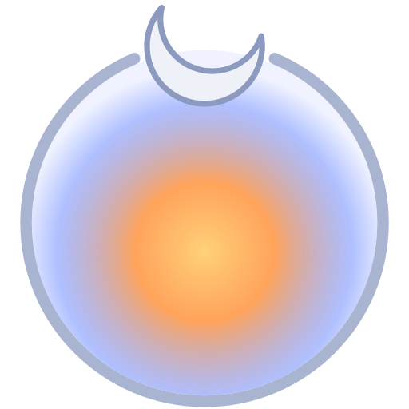

# Sublunary

*The realm of change beneath the Moon, rendered in light.*

An art project about the Moon's astrological motion, and the sky's, taken
seriously as a system of definitions and never claimed as a mechanism. It began
as lights in a house following the Moon through the signs, and grew.

**[Sublunary: Cantata](https://sublunary.app/)** is a birth chart and its transits as a work in six movements:
*Chart*, your birth chart read at three depths, with William Lilly's dignities, combustion and receptions;
*Now*, a forecast of what begins and ends this week; *Moon*, her laps stacked like a seismograph's drum,
from two years down to the hour; *Score*, your transits as a piano roll; *Fold*, every planet as a line
through time with the zodiac folded so aspects become crossings; and *Two*, what passes between two charts
and what the sky does to each. Everything is computed in your browser, so birth data stays with you.

Also here:

- **[Synastry Chords](https://sublunary.app/synastry.html)**: two charts played as one chord.
- **[The Sublunary Sphere](https://sublunary.app/sublunary-sphere.html)**: the sky in 3D, with the Moon's tilted orbit, its nodes Rahu and Ketu, every orb as a cap of light, and a music of the spheres.
- **[The Sublunary Astrolabe](https://sublunary.app/astrolabe.html)**: a lunar month of Lilly's orbs on a zodiac wheel, and what one bulb does with them; with **[Sublunary Houses](https://sublunary.app/houses.html)** and **[Lilly's Orbs on the Sphere](https://sublunary.app/sphere.html)**.

**The Home Assistant integration**, the original lights, now lives in
**[anomalous3/sublunary-ha](https://github.com/anomalous3/sublunary-ha)**. If you
installed it through HACS from this repository, add that one instead (HACS →
⋮ → Custom repositories) and reinstall; your settings carry over.

## What's here

- `sublunary/`: the engine (Skyfield and JPL DE440s): Moon events, void-of-course definitions, Lilly's moieties, houses. The integration carries a copy of it.
- `docs/`: the pages served at sublunary.app.
- `notes/`: the builders and studies behind each page (`notes/score/` is the Cantata).
- `tests/`: validation against the Swiss Ephemeris and published tables.
- `scripts/`: the city list and the light palettes the pages share with the integration.

## Accuracy

Positions come from [Skyfield](https://rhodesmill.org/skyfield/) with JPL
DE440s (apparent geocentric, true ecliptic of date). Moon events agree with
the Swiss Ephemeris to about 1 s median (`tests/validate_swe.py`). Void
periods match the moontracks.com table for Oct–Nov 2026 on all 27 periods
(`tests/compare_moontracks.py`; the fixture cites its source).

## Development

```sh
uv venv .venv && uv pip install skyfield numpy pyswisseph   # engine + oracle
python -m tests.validate_swe 2026
python -m notes.score.build                                  # rebuild the Cantata
```

## License

MIT. Ephemeris data: NASA JPL. City data: [GeoNames](https://www.geonames.org/), CC BY 4.0 (`scripts/build_cities.py`). Orbs: William Lilly, who would have had opinions.
