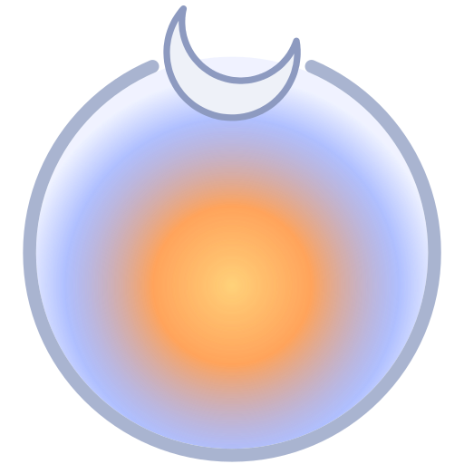

# Sublunary

*The realm of change beneath the Moon, rendered in light.*

A Home Assistant integration that turns the Moon's astrological motion into
sensors (sign, phase, applying aspects, void-of-course) so automations can
drive lights from it. It's an art project: the astrology is taken seriously as
a system of definitions, and none of it is claimed as a mechanism.

**[Watch a lunar month on the Sublunary Astrolabe →](https://anomalous3.github.io/sublunary/)**
Lilly's orbs on a zodiac wheel, and what one bulb does with them. Its companion,
**[Sublunary Houses](https://anomalous3.github.io/sublunary/houses.html)**, shows the sign and natal-house colors, with your own chart computed in the browser.

Void of course is famously contested, so Sublunary computes several
definitions side by side, and the disagreement between them is itself
something you can display.

## Install (HACS)

1. HACS → ⋮ → **Custom repositories** → add `https://github.com/anomalous3/sublunary`, type **Integration**.
2. Install **Sublunary**, restart Home Assistant.
3. Settings → Devices & services → **Add integration** → Sublunary.
4. Every void-of-course definition has its own binary sensor. `lilly_unbounded`
   starts disabled; enable or disable any of them from the entity settings.

On first setup it downloads NASA JPL's `de440s.bsp` ephemeris (~32 MB, covers
1849–2150) into `config/sublunary/`, so the first start needs internet.

## Natal houses (optional)

In Sublunary's options (Settings → Devices & services → Sublunary →
Configure), add your birth date and time, the time zone you were born in, your
birth place, and a house system (Placidus, Whole Sign, Equal or Porphyry).
That adds `sensor.sublunary_moon_house`: the natal house the Moon is passing
through, with the next house change, your Ascendant, MC and cusps. Birth data
stays in your Home Assistant's own config. Placidus falls back to Porphyry
above about 66° latitude, where it stops being defined. Cusps agree with the
Swiss Ephemeris to a few arcseconds (`tests/validate_houses.py`).

## Entities

| Entity | State | Notable attributes |
|---|---|---|
| `sensor.sublunary_moon_sign` | sign | `next_ingress` |
| `sensor.sublunary_moon_phase` | one of 8 phases | `illumination`, `elongation`, `next_phase`, `next_phase_at` |
| `sensor.sublunary_dominant_contact` | body the Moon is applying to, or `none` | `aspect`, `depth` (0→1 toward perfection), `in_sign`, `tone` (warm/cool), `perfects`, `contacts` |
| `binary_sensor.sublunary_void_of_course_<definition>` | on while void | `start`, `end`, `last_aspect`, `next_start`, `next_end` |
| `sensor.sublunary_next_aspect` | the aspect after the one being shown now, or `void` if the Moon goes void first (modern definition) | `aspect`, `perfects`, `in_sign`, `tone`; when void: `void_starts`, `void_ends`, `then` |
| `sensor.sublunary_next_change` | when the dominant contact (and the light) next changes | `to` (a body, or `none` for void), `aspect`, `in_sign`, `tone` |
| `sensor.sublunary_moon_house` | natal house 1-12 (only with a natal chart) | `next_house`, `next_house_at`, `ascendant`, `midheaven`, `cusps`, `house_system` |
| `sensor.sublunary_clock` | the time Sublunary thinks it is | `simulated`, `speed`, `paused` |

## Void-of-course definitions

- **modern**: from the Moon's last Ptolemaic aspect (to any of Sun through Pluto) until she enters the next sign.
- **traditional**: the same, using only the seven traditional bodies.
- **lilly**: William Lilly's moieties (*Christian Astrology*, 1647). Each body
  has an orb; contact begins when the Moon is within the sum of the half-orbs.
  She's not void if she comes within orbs of an aspect before leaving the sign,
  even if it perfects in the next one.
- **lilly_unbounded**: void whenever no applying contact exists at all, regardless of sign.

The dominant contact uses Lilly's orbs for all bodies (outer planets get a
placeholder 5°, since Lilly never saw them). In-sign contacts outrank
boundary-crossing ones, and depth breaks ties.

## Blueprints

All four share the same light handling:

- **Power.** *Only adjust lights that are on* (default) never turns a light
  on, so a light someone switched off stays off; switching it back on hands it
  to Sublunary, which applies the sky at once. *Full control* turns lights on
  and off.
- **Void.** *Dim moonlight* (default: 4000 K at 3%, both adjustable) or *Off*
  (only with full control, or the light could never come back).

Import any of them by URL from the Blueprints page. They're generated by
`scripts/build_blueprints.py`.

### Consensus light (`consensus_light.yaml`)

Hue shows which kind of planet the Moon is reaching for (warm for traditional,
cool for outer). Brightness shows how many definitions agree she's reaching at
all: bright in-sign, faint when only Lilly's orbs reach across the sign
boundary.

### Planet colors (`planet_colors.yaml`)

The bulb takes the color of the planet the Moon is reaching for, with the same
consensus brightness.

| Body | Hybrid (default) | Golden Dawn |
|---|---|---|
| Sun | warm white, 2700 K (the bulb's white LEDs) | orange |
| Mercury | quicksilver | yellow |
| Venus | green | emerald |
| Mars | red | scarlet |
| Jupiter | violet | violet |
| Saturn | deep indigo | indigo |
| Uranus | electric cyan | from Hybrid |
| Neptune | sea blue | from Hybrid |
| Pluto | magenta | from Hybrid |

Hybrid uses what you'd see through a telescope where a planet has a color, and
tradition where it's only white or grey. **Custom** lets you set every color
(prefilled with Hybrid, with a toggle for the Sun as warm white). Blues and
violets crowd together on cheap bulbs, so check Neptune, Saturn and Jupiter on
yours.

### Sign colors (`sign_colors.yaml`)

A color for the Moon's sign: **Elements** (fire red-orange, earth green, air
sky cyan, water deep blue), the **Golden Dawn** spectrum walked around the
zodiac, or Custom. Fixed brightness.

### House colors (`house_colors.yaml`)

A color for the natal house the Moon is passing through, using each house's
natural sign (1st Aries, 2nd Taurus, ...). Needs a natal chart in Sublunary's
options.

## Simulated clock

```yaml
action: sublunary.set_clock
data:
  start: "2026-10-16 01:00:00"   # optional
  speed: 1440                    # a day per real minute
```

`sublunary.reset_clock` returns to real time. Fades in the blueprint shrink
with the clock speed. The clock pauses at the edge of the ephemeris range.

## Accuracy

Positions come from [Skyfield](https://rhodesmill.org/skyfield/) with JPL
DE440s (apparent geocentric, true ecliptic of date). Moon events agree with
the Swiss Ephemeris to about 1 s median (`tests/validate_swe.py`). Void
periods match the moontracks.com table for Oct–Nov 2026 on all 27 periods
(`tests/compare_moontracks.py`; the fixture cites its source).

## Development

```sh
uv venv .venv && uv pip install skyfield numpy pyswisseph   # engine + oracle
python -m tests.validate_swe 2026
uv venv .venv-ha && uv pip install pytest-homeassistant-custom-component skyfield
.venv-ha/bin/python -m pytest                                # real HA core
```

The engine lives in `sublunary/` and is vendored into
`custom_components/sublunary/engine/` by `scripts/vendor_engine.sh`. A test
fails if the two drift apart.

## License

MIT. Ephemeris data: NASA JPL. Orbs: William Lilly, who would have had opinions.
